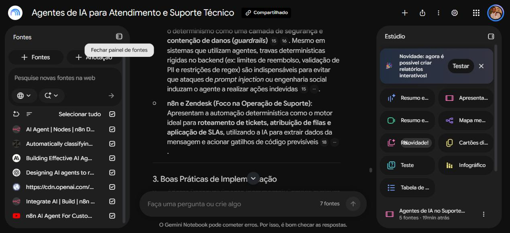
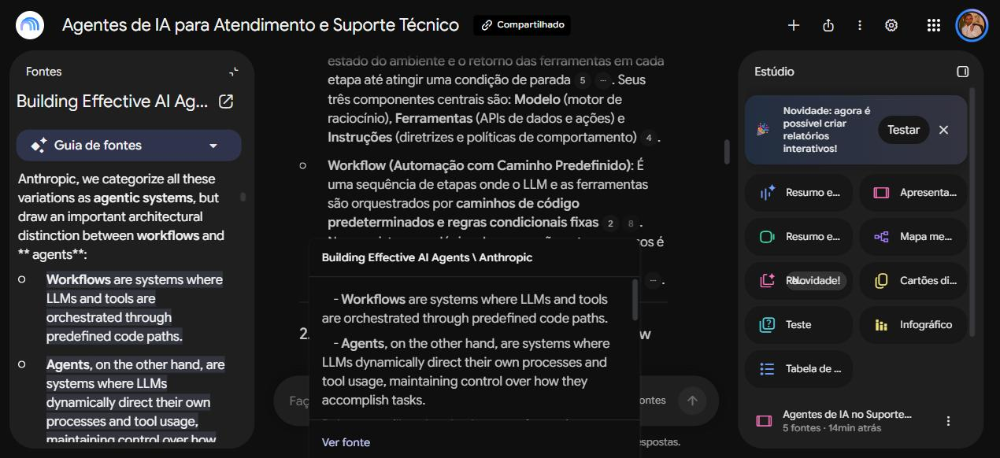
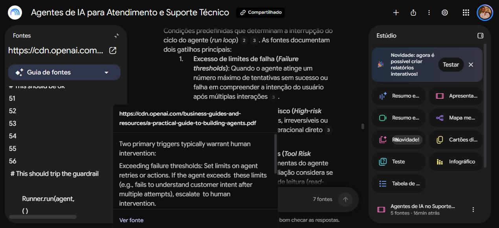
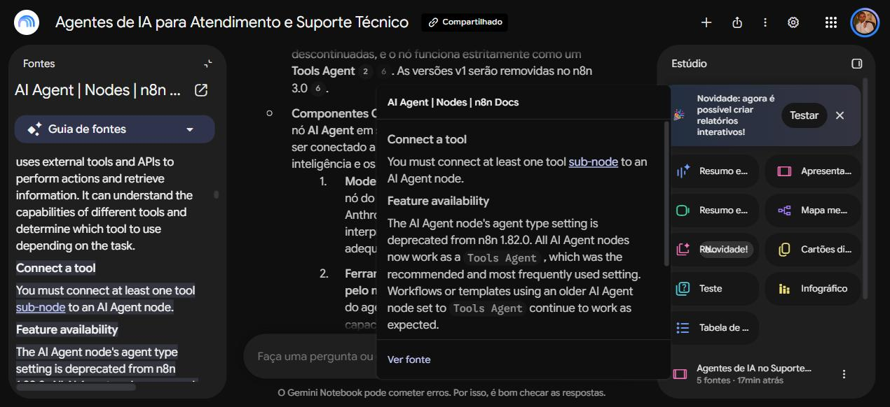
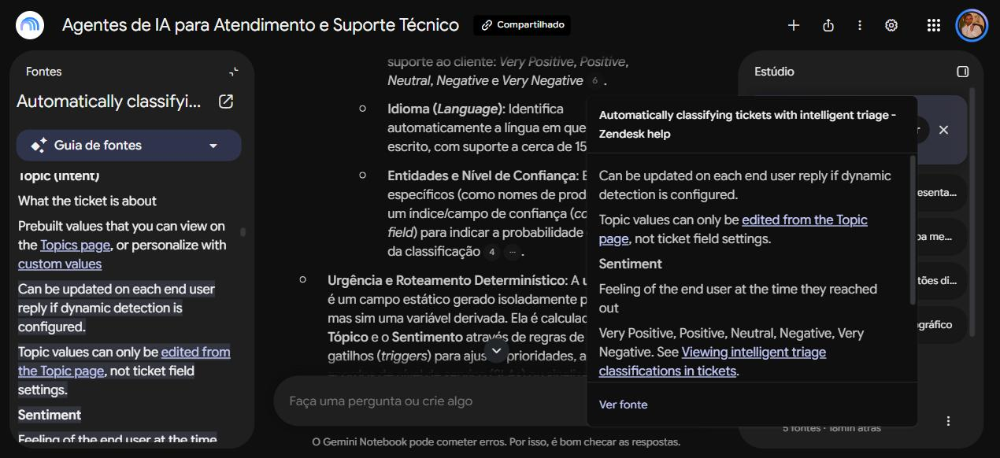
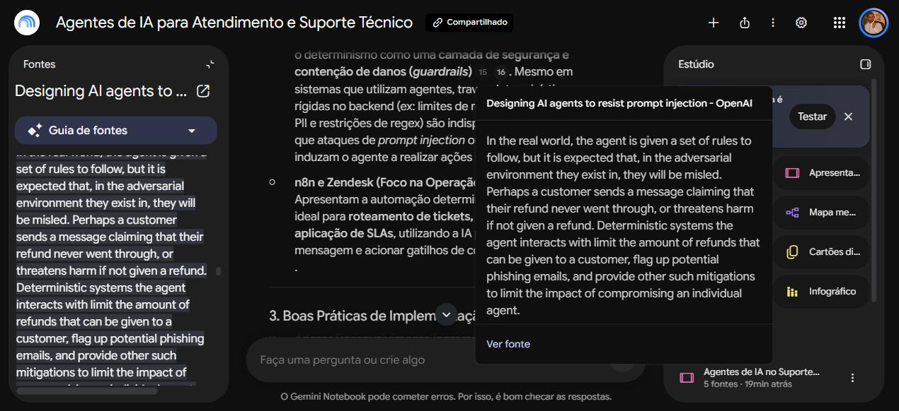

# Segundo Cérebro com IA: Agentes de IA para Atendimento e Suporte Técnico

Notebook especialista criado no **Gemini Notebook** (antigo NotebookLM) para o desafio da DIO. Ele responde apenas com base nas fontes que selecionei, mostra de onde tirou cada resposta e gera materiais de estudo.

**Notebook compartilhado:** [Agentes de IA para Atendimento e Suporte Técnico](https://notebook.google.com/notebook/94f203a5-ca06-46b7-8765-fbded1f764d4)

## Objetivo

> Quero montar no Gemini Notebook um segundo cérebro sobre **agentes de IA para automação de atendimento e suporte técnico** para entender como projetar, implementar e operar agentes que classifiquem solicitações, consultem informações, executem ações e escalonem casos para humanos com segurança.

## Por que este tema

- Trabalho como analista de tecnologia e lido com demandas de suporte no dia a dia.
- Estou estudando automação com n8n e quero entender quando um agente de IA faz sentido e quando uma automação simples resolve.
- Quero aplicar o que aprendi em um fluxo real de triagem e atendimento de chamados.

## Fontes selecionadas

O notebook tem 7 fontes em 4 formatos (PDF, artigo, documentação e vídeo), todas em inglês.

| # | Fonte | Formato | Por que confio | Link |
|---|---|---|---|---|
| 1 | OpenAI — *A Practical Guide to Building Agents* | PDF | Guia oficial de quem desenvolve os modelos. Cobre definição de agente, quando usar, fundamentos de design, guardrails e escalonamento humano | [PDF](https://cdn.openai.com/business-guides-and-resources/a-practical-guide-to-building-agents.pdf) |
| 2 | Anthropic — *Building Effective Agents* (Erik S. e Barry Zhang, dez/2024) | Artigo | Artigo de engenharia com autoria e data. Distingue workflows de agentes e cita suporte ao cliente como caso de uso | [Artigo](https://www.anthropic.com/engineering/building-effective-agents) |
| 3 | n8n Docs — AI Agent node | Documentação | Documentação oficial da ferramenta que uso no bootcamp | [Docs](https://docs.n8n.io/integrations/builtin/cluster-nodes/root-nodes/n8n-nodes-langchain.agent) |
| 4 | n8n Docs — Integrate AI | Documentação | Documentação oficial sobre agentes, ferramentas, memória e modelos no n8n | [Docs](https://docs.n8n.io/build/integrate-ai) |
| 5 | Ashton Voss — *n8n AI Agent For Customer Service: Tutorial + Free Template* (jul/2025, 21 min) | Vídeo YouTube | Tutorial prático com demo real: agente que consulta CRM, cria contatos e abre/consulta tickets | [Vídeo](https://www.youtube.com/watch?v=zPgHsjbbbQk) |
| 6 | Zendesk Help — *Automatically classifying tickets with intelligent triage* | Documentação | Encontrada pelo Deep Research. Documentação oficial de uma das maiores plataformas de helpdesk, com detalhes concretos de classificação por tópico, sentimento e idioma | [Docs](https://support.zendesk.com/hc/en-us/articles/4550640560538-Automatically-classifying-tickets-with-intelligent-triage) |
| 7 | OpenAI — *Designing AI agents to resist prompt injection* (Thomas Shadwell e Adrian Spânu, mar/2026) | Artigo | Encontrada pelo Deep Research. Artigo recente, com autoria, que usa justamente o exemplo de um agente de suporte que emite reembolsos | [Artigo](https://openai.com/index/designing-agents-to-resist-prompt-injection/) |

### Critérios de seleção

Antes de aceitar uma fonte, conferi: autoria identificável, autoridade (fonte oficial ou especialista reconhecido), atualidade, presença de exemplos e evidências, utilidade para o objetivo e possibilidade de compartilhamento público.

### Uso do Deep Research

Pesquisei *"Boas práticas para agentes de IA no atendimento ao cliente e suporte técnico: triagem de chamados, guardrails e escalonamento para atendimento humano"*. O Deep Research sugeriu 23 fontes e um relatório gerado por IA. Abri e conferi as candidatas e **importei só 2** (Zendesk e OpenAI).

**Fontes descartadas e motivo:**

- **Relatório gerado pelo próprio Deep Research:** é um texto produzido por IA, não uma fonte primária.
- **Blogs de fornecedores (Sim, Bland AI, AethoVPN, BoldDesk, JieGou, BlueTweak, Salted CX, Aissist):** conteúdo com viés comercial, em geral promovendo o próprio produto.
- **OpenAI Cookbook — *How to implement LLM guardrails*:** a própria página informa que a receita está arquivada (2023) e pode citar modelos e APIs desatualizados.
- **Artigos genéricos sobre guardrails (Medium, DataAspirant, Last9, Confident AI):** pouco ligados a suporte técnico, ou sem autoria institucional clara.

## Diretriz do notebook

Configurada em "Configurar as conversas" → "Personalizado":

```text
Comporte-se como um especialista em agentes de IA para automação
de atendimento e suporte técnico.

Responda apenas com base nas fontes deste notebook e sempre cite
a fonte que sustenta a resposta.

Diferencie claramente: (1) conceitos documentados, (2) boas práticas,
(3) exemplos práticos e (4) riscos e limitações.

Quando as fontes divergirem, apresente as diferenças.
Se algo não estiver nas fontes, diga isso explicitamente.

Responda em português do Brasil, com linguagem técnica clara e
exemplos aplicados a suporte técnico.
```



## Perguntas e respostas

Todas as respostas foram geradas pelo notebook com as 7 fontes selecionadas e seguiram a estrutura pedida na diretriz. Nos prints, a citação está aberta e o trecho original aparece destacado no painel de fontes.

### 1. O que caracteriza um agente de IA e como ele difere de um workflow?

**Resumo da resposta:** um agente de IA é um sistema guiado por um LLM que decide dinamicamente quais passos seguir e quais ferramentas usar, em um ciclo (loop) até atingir o objetivo. Seus componentes centrais são modelo, ferramentas e instruções. Já um workflow segue caminhos de código predefinidos: é mais previsível e consistente, enquanto o agente é mais flexível para casos abertos. Como boa prática, o notebook recomendou começar pela solução mais simples e só adotar agentes quando o fluxo fixo não resolver. Os riscos citados foram mais latência e custo, erros que se acumulam e prompt injection.

**Fontes citadas:**
- Anthropic — *Building Effective Agents*: "Workflows are systems where LLMs and tools are orchestrated through predefined code paths. Agents, on the other hand, are systems where LLMs dynamically direct their own processes and tool usage…"
- OpenAI — *A Practical Guide to Building Agents*: os componentes modelo, ferramentas e instruções.
- n8n Docs — AI Agent: o agente escolhe a ferramenta conforme a tarefa.



### 2. Quando um agente deve escalonar para um humano, e quais ações exigem aprovação?

**Resumo da resposta:** as fontes apontam dois gatilhos de escalonamento: exceder limites de falha (por exemplo, não entender a intenção do cliente depois de várias tentativas) e executar ações de alto risco. Devem exigir aprovação humana: reembolsos altos, pagamentos, cancelamentos, envio de dados pessoais e alterações de escrita em sistemas como o CRM. O notebook também citou classificar as ferramentas por risco (somente leitura x escrita, reversível ou não) e escalar automaticamente chamados com sentimento muito negativo. Ao comparar as fontes, a Anthropic trata o humano como ponto de checagem de qualidade, a OpenAI como barreira de segurança, e Zendesk e n8n como roteamento operacional.

**Fontes citadas:**
- OpenAI — *A Practical Guide to Building Agents*: "Two primary triggers typically warrant human intervention: Exceeding failure thresholds… High-risk actions…"
- OpenAI — *Designing AI agents to resist prompt injection*: source-sink analysis e confirmação antes de transmitir dados.
- Zendesk — intelligent triage: sentimento como critério de roteamento.



### 3. Como funciona o nó AI Agent do n8n?

**Resumo da resposta:** o AI Agent é um nó raiz que recebe a mensagem, raciocina em loop e escolhe as ferramentas. Desde a versão 1.82.0, ele funciona sempre como *Tools Agent*. Precisa de sub-nós: um modelo de chat, **pelo menos uma ferramenta**, memória (com uma chave de sessão por cliente) e, opcionalmente, um vector store para RAG. No exemplo do vídeo, o fluxo recebe a mensagem do WhatsApp, busca o contato no HubSpot, consulta os tickets, faz a busca RAG no Supabase, cria o ticket e avisa a equipe pelo Telegram.

**Fontes citadas:**
- n8n Docs — AI Agent: "You must connect at least one tool sub-node to an AI Agent node." e a mudança para Tools Agent na versão 1.82.0.
- n8n Docs — Integrate AI.
- Vídeo de Ashton Voss: fluxo com HubSpot, Supabase e Telegram.



### 4. Como montar um fluxo de triagem de chamados com IA?

**Resumo da resposta:** a IA classifica o chamado por tópico (intenção), sentimento (5 níveis), idioma (cerca de 150) e nível de confiança, a partir do assunto e da primeira mensagem. A urgência não sai pronta do modelo: ela é derivada de regras que cruzam tópico e sentimento. Para isso, o notebook propôs um fluxo no n8n: o WhatsApp Trigger recebe a mensagem e um classificador devolve um JSON com {tópico, urgência, sentimento, idioma}. Se o chamado for urgente, um nó do Telegram avisa a equipe e um ticket prioritário é aberto no HubSpot. Se for uma dúvida comum, o AI Agent responde consultando a base RAG. Entre os riscos, a classificação dinâmica pode trocar o tópico por causa de uma resposta curta como "ok, obrigado".

**Fontes citadas:**
- Zendesk — intelligent triage: classificação por tópico, sentimento e idioma; atualização a cada resposta quando a detecção dinâmica está ativa.
- Anthropic — padrão de *routing*.
- Vídeo de Ashton Voss e n8n Docs: implementação no n8n.



### 5. Quando uma automação determinística é melhor que um agente? As fontes divergem?

**Resumo da resposta:** segundo o notebook, as fontes **não divergem**, e todas convergem no princípio da simplicidade. O que muda é o foco de cada uma: a Anthropic olha para custo e latência, a OpenAI para segurança (travas determinísticas, como um limite de reembolso, contêm um agente manipulado) e Zendesk e n8n para a operação (roteamento e SLAs). A automação determinística é melhor para redefinição de senha, triagem e roteamento e reembolsos pequenos. O agente é melhor para diagnóstico técnico com sintomas ambíguos. A recomendação final foi uma arquitetura híbrida: workflow na camada externa e agente só para resolver problemas abertos.

**Fontes citadas:**
- Anthropic — *Building Effective Agents*: começar pelo mais simples.
- OpenAI — *Designing AI agents to resist prompt injection*: "Deterministic systems the agent interacts with limit the amount of refunds that can be given to a customer…"
- Zendesk e n8n: roteamento determinístico.



## Materiais gerados no Estúdio

| Material | Arquivo |
|---|---|
| Mapa mental (fundamentos, arquitetura, casos de uso, escalonamento, riscos, boas práticas e n8n) | [mapa-mental.png](materiais/mapa-mental.png) |
| Slides "Agentes de IA no Suporte Técnico com n8n" (10 slides) | [slides.pdf](materiais/slides.pdf) |
| Guia de estudo com quiz | [guia-de-estudos.pdf](materiais/guia-de-estudos.pdf) |

## Aprendizados

- **A distinção central:** workflow e agente diferem em quem controla o fluxo, o código ou o modelo. No suporte, a melhor solução costuma ser híbrida.
- **Onde as fontes concordaram:** comece pelo mais simples, mantenha um humano no circuito para ações de alto risco e limite o que o agente pode fazer.
- **Onde elas se complementam:** a Anthropic olha para arquitetura e custo, a OpenAI para segurança e guardrails, e n8n e Zendesk para a operação do dia a dia.
- **Aplicação no trabalho:** usar IA para classificar chamados e regras determinísticas no n8n para rotear e priorizar, deixando o AI Agent apenas para dúvidas abertas com base de conhecimento.

## Próximos passos

- Adicionar uma fonte em português e comparar as respostas.
- Ouvir o resumo em áudio como revisão.
- Construir no n8n o fluxo de triagem descrito na resposta 4.
